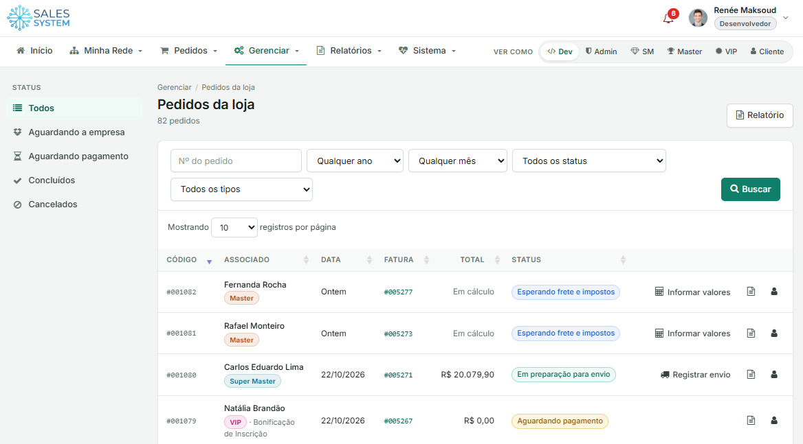
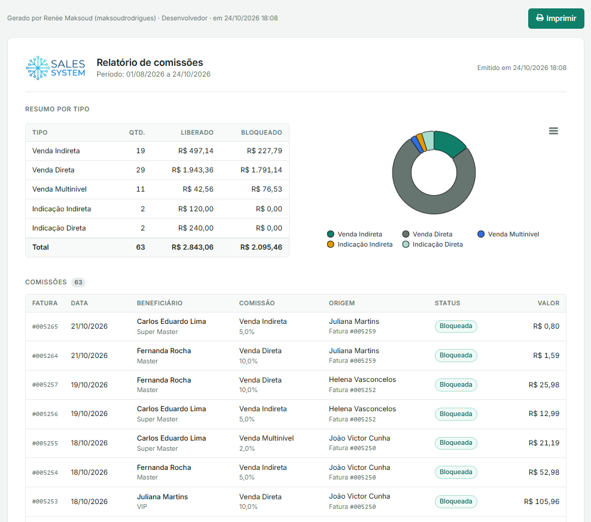

# Sales-System

Painel de gestão para empresas que vendem por meio de uma **rede de associados**: controla quem
entra na rede, o que cada um compra, quanto cada um ganha de comissão, as metas e bonificações,
o caixa da empresa e a entrega de cada pedido. Feito em **CakePHP 3.4** para a rede **Reiniciando**.

Produção: <http://reiniciando.com.br/Sales-System/>



> **Estado atual:** demonstração funcional, sem banco de dados. Todas as telas dos 6 perfis
> funcionam com **dados simulados** gerados por `src/Lib/DemoData.php`: uma rede de 35 usuários,
> cerca de 80 pedidos e 270 faturas (taxas, pedidos, comissões e saques) coerentes entre si, com
> datas relativas ao dia atual. Formulários e ações (salvar, baixar, cancelar, excluir) apenas
> simulam a gravação e exibem uma mensagem "(demonstração: nenhum dado foi alterado)".

---

## O problema

Uma empresa que vende por indicação (venda direta ou marketing multinível) não tem só clientes:
tem uma **rede em árvore** de revendedores, em que cada pessoa foi trazida por outra
(o "patrocinador"). Cada venda feita lá embaixo gera dinheiro para várias pessoas acima.

Sem um sistema próprio, essa operação costuma viver em planilhas, e-mails e mensagens, e os
problemas aparecem rápido:

- **Comissões calculadas à mão.** Um único pedido pode gerar comissão para três pessoas diferentes,
  com percentuais diferentes. Basta a rede crescer um pouco para os erros e as reclamações começarem.
- **Ninguém sabe o próprio saldo.** O associado não sabe quanto já ganhou, quanto pode sacar e
  quanto ainda está bloqueado, e passa a depender da empresa para cada consulta.
- **Pedidos sem acompanhamento.** O frete e o imposto variam por destino, o pagamento pode ser
  parcelado e o envio precisa de rastreio. Sem um fluxo claro, o pedido some entre uma etapa e outra.
- **Metas e prêmios sem controle.** Bonificações por indicação ou por volume de vendas são
  prometidas, mas ninguém acompanha quem já atingiu a meta.
- **Território sem dono.** Dois revendedores disputam a mesma cidade, e não há registro de quem
  tem exclusividade em qual região.
- **Todo mundo vê tudo, ou ninguém vê nada.** A empresa precisa ver a rede inteira; o associado,
  só a própria rede e o próprio dinheiro; o cliente final, só os próprios pedidos.

## Como o Sales-System resolve

O sistema reúne tudo num só painel, com **regras configuráveis** e uma **visão diferente para
cada perfil**. Toda movimentação vira uma **fatura** (taxa de inscrição, pedido, comissão ou
saque), então o saldo de cada pessoa e o caixa da empresa são sempre calculados a partir dos
mesmos registros, sem conta paralela.

O ciclo de uma venda, do início ao fim:

```
Associado faz o pedido na loja
  └─> Empresa informa frete e ICMS ──> Fatura enviada ──> Associado paga
        └─> Comissões geradas automaticamente para até 3 níveis acima (bloqueadas)
        └─> Empresa prepara e registra o envio (data, previsão, rastreio, nota fiscal)
              └─> Pedido entregue e concluído
  30 dias depois do pagamento: comissões liberadas ──> associado solicita saque ──> empresa paga
```

### Perfis de acesso

O menu, o painel inicial e os dados exibidos mudam conforme o perfil de quem entra.

| Perfil | Quem é | O que vê e faz |
|---|---|---|
| **Desenvolvedor** | Equipe técnica | Tudo o que o Administrador faz, mais o menu **Sistema**: regiões, planos, metas, regras de comissão, produtos, usuários, atualização do sistema e modo debug |
| **Administrador** | A empresa | Gestão de toda a rede: pedidos da loja, extrato geral, taxas de inscrição, faturas de pedidos e de comissões, pagamento de saques, extrato da empresa, avisos, lançamento de bonificações e todos os relatórios |
| **Super Master** | Topo da rede, em geral responsável por uma região | Loja, os próprios pedidos, a própria rede em árvore, cadastro de novos associados, extrato, saldo, saques, metas e envio de avisos para a própria rede |
| **Master** | Revendedor intermediário | O mesmo que o Super Master, com as metas e comissões do seu plano |
| **VIP** | Revendedor de entrada | Loja, pedidos, rede, cadastro de associados, extrato, saldo, saques e metas. Não envia avisos |
| **Cliente** | Consumidor final | Só a loja, os próprios pedidos e o próprio extrato |

Os perfis de gestão (Desenvolvedor e Administrador) **não recebem comissões**: a cadeia de
comissões para quando chega neles.

Enquanto a taxa de inscrição de um associado não é paga, o cadastro fica **pendente**: ele entra
no painel e vê a rede e o extrato, mas a loja, o cadastro de novos associados e o saque ficam
bloqueados.

Para testes, o seletor **"Ver como"** no topo da tela troca o perfil da sessão na hora
(veja [Tipos de acesso](#tipos-de-acesso-perfis)).

### Planos e taxa de inscrição

Cada perfil da rede (Super Master, Master e VIP) é um **plano** com:

- **Taxa de inscrição**, paga pelo associado para ativar o cadastro;
- **Bonificação de inscrição**: produtos que ele ganha ao entrar (gera um pedido automático, sem custo);
- **Meta mínima de vendas** por mês.

Nos dados de demonstração, por exemplo: Super Master paga R$ 15.000 e recebe 30 mineralizadores;
Master paga R$ 5.000 e recebe 10; VIP paga R$ 1.200 e recebe 3. Na **mudança para um plano
maior**, o sistema gera uma fatura só com a diferença entre as taxas.

### Comissões

As regras ficam em **Sistema > Comissões** e combinam três coisas:

1. **Origem do dinheiro:** taxa de inscrição (comissão de *indicação*) ou pedido da loja, sem o
   frete (comissão de *venda*);
2. **Nível na rede:** 1 nível acima é o patrocinador de quem pagou; 2 níveis, o patrocinador dele;
   3 níveis, o seguinte;
3. **Percentual**, que pode ser limitado ao plano de quem paga e ao plano de quem recebe.

Daí saem os seis tipos de comissão:

| Tipo | Origem | Nível | Exemplo da demonstração |
|---|---|---|---|
| Indicação Direta | Taxa de inscrição | 1 | 10% |
| Indicação Indireta | Taxa de inscrição | 2 | 5% |
| Indicação Multinível | Taxa de inscrição | 3 | 2% |
| Venda Direta | Pedido da loja | 1 | 10% |
| Venda Indireta | Pedido da loja | 2 | 5% |
| Venda Multinível | Pedido da loja | 3 | 2% |

**Exemplo:** uma cliente indicada por um VIP paga um pedido de R$ 1.000 (sem frete). O sistema
gera, sozinho, uma fatura de comissão de R$ 100 para o VIP, R$ 50 para o Master acima dele e
R$ 20 para o Super Master acima do Master. Cada produto pode ser marcado para **gerar ou não
comissões** (peças de reposição, por exemplo, podem ficar de fora).

Toda comissão nasce **bloqueada** e é **liberada 30 dias** depois do pagamento da fatura de
origem. Só faturas efetivamente pagas geram comissão.

### Financeiro, saldos e saques

Cada movimentação é uma fatura, com forma de pagamento, parcelas, vencimento, boleto e nota fiscal:

| Fatura | Gerada quando |
|---|---|
| **Taxa** | Um associado se cadastra num plano ou sobe de plano |
| **Pedido** | Um pedido recebe frete e impostos; pode ser parcelado (uma fatura por parcela) |
| **Comissão** | Uma taxa ou pedido é pago, para cada pessoa da rede que tem direito |
| **Saque** | O associado pede para receber o saldo disponível |

- O associado vê no painel e no **Meu Extrato** o saldo **disponível** (comissões liberadas
  menos saques) e o **bloqueado** (comissões a receber).
- O **saque** sai do saldo disponível, com valor mínimo de R$ 50, e vai para os dados bancários
  ou Pix cadastrados. A empresa confirma o pagamento em até 5 dias úteis.
- A gestão acompanha o **Extrato Geral** (todas as faturas, com filtros por tipo, status, período
  e associado), as **solicitações de saque** a pagar e o **Extrato da Empresa**, que é o caixa:
  taxas e pedidos recebidos, saques pagos.
- O painel inicial da gestão destaca pedidos aguardando a empresa, saques a pagar, faturas
  vencidas e o total recebido no mês.

### Produtos, loja e entregas

O catálogo fica em **Sistema > Produtos**: nome, descrição, imagem, preço, ordem na loja,
ativo/inativo e se gera comissões. Produtos inativos saem da loja, mas continuam nos pedidos antigos.

Os associados e clientes compram pela **Loja**. A gestão acompanha tudo em
**Gerenciar > Pedidos da loja** (print no topo), com filtros por número, ano, mês, status e tipo,
e um atalho na lateral para os pedidos que **aguardam a empresa**. Cada pedido passa por estas etapas:

| Status | O que acontece | Quem age |
|---|---|---|
| Esperando frete e impostos | Pedido feito; o valor final ainda depende do destino | Empresa informa o frete e, se for o caso, o ICMS antecipado (associado contribuinte de ICMS em outro estado) e envia a fatura |
| Aguardando pagamento | Fatura enviada ao associado | Associado paga |
| Em preparação para envio | Pagamento confirmado | Empresa separa e registra o envio: data, previsão de entrega, código de rastreio e nota fiscal |
| Aguardando entrega | Pedido despachado, com rastreio visível para o associado | Transportadora |
| Concluído | Pedido entregue | |
| Cancelado | Pedido cancelado; as faturas ligadas a ele também são canceladas e não geram comissão | |

Há três tipos de pedido: **Normal** (compra na loja), **Bonificação de Inscrição** (produtos do
plano, gerados ao entrar na rede) e **Bonificação por Meta** (lançada pela gestão quando um
associado atinge uma meta). As bonificações têm valor zero, mas seguem o mesmo fluxo de entrega.

### Metas e bonificações

Em **Sistema > Metas** a empresa define prêmios por desempenho, para cada plano:

- **Meta de indicação:** cadastrar e ativar um número de novos associados de um plano.
  Ex.: o Super Master que trouxer 10 Masters ganha 10 mineralizadores.
- **Meta de venda:** comprar e pagar uma quantidade de um produto.
  Ex.: o VIP que vender 50 refis ganha 5 refis.

Cada associado vê o **progresso das suas metas** no painel inicial, em barras de andamento.
O relatório de metas mostra quem já atingiu cada uma, e a gestão lança a bonificação como pedido.

### Regiões

Em **Sistema > Regiões** a empresa cadastra os estados atendidos, as cidades de cada um e o
**associado responsável**. Uma região **exclusiva** só pode ser trabalhada pelo responsável; nas
não exclusivas, qualquer associado atua conforme o plano. Cada associado fica ligado à região do
seu patrocinador, o que permite separar vendas e cadastros por território.

### Rede e cadastro de associados

- **Minha Rede** mostra a árvore de indicados a partir do usuário logado (a gestão vê a rede inteira).
  Cada nó abre e fecha os indicados abaixo dele.
- O próprio associado cadastra novos membros da sua rede, que já nascem ligados a ele como patrocinador.
- Cada usuário mantém seus dados pessoais (pessoa física ou jurídica), endereço, senha e dados
  bancários/Pix para receber os saques.

### Avisos

A gestão publica **avisos** para todos ou só para um plano, com validade opcional. Super Masters e
Masters também enviam avisos para a própria rede. Os avisos pendentes aparecem no **sino** do
cabeçalho, com contador.

### Relatórios

Os relatórios abrem prontos para **impressão ou PDF**, com período, resumo e totais (alguns com gráficos):

| Relatório | O que mostra |
|---|---|
| Pedidos | Pedidos dos associados por período e status |
| Faturas | Faturas de pedidos, inscrições e saques |
| Metas | Associados e o andamento de cada meta |
| Comissões | Comissões por tipo (liberado e bloqueado), beneficiário, origem e status |
| Associados | Associados cadastrados, com plano, patrocinador, cidade e status |
| Clientes | Clientes finais cadastrados |
| Pagamentos | Saques pagos aos associados |
| Saldos | Saldo disponível e bloqueado de cada associado |
| Cadastros | Novos cadastros por mês e plano nos últimos 12 meses, com as taxas recebidas |
| Impostos | Tabela de ICMS por estado de destino |



---

## Módulos (código)

| Controller | Telas |
|---|---|
| `OrdersController` | Loja, Meus Pedidos, Pedidos da Loja, detalhes, envio, frete e impostos |
| `InvoicesController` | Extrato Geral, Saques, Taxas, Faturas de Pedidos e de Comissões, Meu Extrato, Solicitar Saque |
| `NoticesController` | Avisos (gestão) e o sino de avisos pendentes do cabeçalho |
| `UsersController` | Minha Rede, Cadastrar Associado, Meus Dados, senha, dados bancários, Sistema > Usuários |
| `ProductsController` | Sistema > Produtos |
| `ReportsController` | Relatórios para impressão: pedidos, faturas, metas, comissões, associados, clientes, pagamentos, saldos, cadastros e impostos |

Para ligar ao banco no futuro, troque as chamadas a `DemoData` nos controllers por consultas ao ORM;
os campos das entidades seguem o esquema do projeto de origem (`mineralli.sql`).

---

## Requisitos

| Item | Versão / observação |
|---|---|
| PHP | 7.4 (testado). Funciona em PHP 8 graças às correções em `vendor/` |
| Extensões PHP | `intl`, `mbstring`, `openssl`, `pdo_mysql`, `simplexml` |
| Servidor web | Apache com `mod_rewrite` e `AllowOverride All`. Ex.: XAMPP, Laragon, WAMP |
| MySQL | 5.6+ (opcional por enquanto, veja [Banco de dados](#banco-de-dados)) |

Para conferir as extensões instaladas: `php -m`

---

## Instalação local

### 1. Clone o projeto dentro da pasta do servidor web

```bash
# Exemplo com XAMPP
cd C:/xampp/htdocs
git clone <url-do-repositorio> Sales-System
```

**Não precisa rodar `composer install`.** A pasta `vendor/` já vem no repositório
(veja [Por que o vendor/ está no Git](#por-que-o-vendor-está-no-git)).

### 2. Crie o arquivo de configuração

O `config/app.php` não fica no Git porque guarda o salt e as senhas. Crie o seu a partir do exemplo:

```bash
cp config/app.default.php config/app.php
```

Gere um salt aleatório:

```bash
php -r "echo bin2hex(random_bytes(32)), PHP_EOL;"
```

Abra o `config/app.php`, procure `__SALT__` e troque pelo valor gerado.

Os pontos que você pode precisar ajustar estão marcados com **`[AJUSTE]`** no arquivo:

| # | Chave | O que colocar |
|---|---|---|
| 1 | `debug` | `true` em desenvolvimento, `false` em produção |
| 2 | `Security.salt` | O valor gerado acima. Único por instalação; nunca publique |
| 3 | `EmailTransport` / `Email` | Servidor SMTP e remetente. Só se for enviar e-mail |
| 4 | `Datasources.default` | Host, usuário, senha e nome do banco MySQL |

Esses valores também podem vir de variáveis de ambiente: `DEBUG`, `SECURITY_SALT`,
`DATABASE_URL` e `EMAIL_TRANSPORT_DEFAULT_URL`.

### 3. Permissões de escrita

O servidor web precisa gravar em `tmp/` e `logs/`. No Windows normalmente já funciona.
No Linux:

```bash
chmod -R 775 tmp logs
chown -R www-data:www-data tmp logs   # ajuste o usuário do Apache
```

### 4. Acesse

Abra no navegador o endereço da pasta, por exemplo:

```
http://localhost/Sales-System/
```

O `.htaccess` da raiz encaminha tudo para `webroot/`, então não é preciso apontar o
Apache para a pasta `webroot`.

**Alternativa sem Apache**, usando o servidor embutido do CakePHP:

```bash
php bin/cake.php server
# abre em http://localhost:8765
```

---

## Banco de dados

Hoje **o sistema abre sem banco configurado**: as consultas estão comentadas nos controllers
(`src/Controller/*Controller.php`), que enviam listas vazias para as telas.

Quando as consultas forem reativadas, o banco precisará das tabelas usadas pelos models:

| Tabela | Model |
|---|---|
| `regions` | `RegionsTable` |
| `goal_plans` | `GoalPlansTable` |
| `sale_goals` | `SaleGoalsTable` |
| `sale_commissions` | `SaleCommissionsController` (model ainda não criado) |
| `usuarios` | Login (`Auth` em `AppController`) |

O repositório ainda não tem o script de criação dessas tabelas. `config/schema/` contém apenas
os SQLs padrão do CakePHP (sessões e i18n).

---

## Tipos de acesso (perfis)

O painel muda conforme o perfil. Na barra do menu, o seletor **"Ver como"** troca o perfil
da sessão atual para testes:

| ID | Perfil | Nome exibido |
|---|---|---|
| 1 | `Dev` | Desenvolvedor |
| 2 | `Admin` | Administrador |
| 3 | `SM` | Super Master |
| 4 | `Master` | Master |
| 5 | `VIP` | VIP |
| 6 | `Cliente` | Cliente |

Os IDs ficam em `config/bootstrap.php`. Os nomes ficam em `AppController::planos()`.
Os menus de cada perfil ficam em `src/Template/Element/menus/`.

---

## Estrutura

```
config/
  app.default.php     Exemplo de configuração (versionado)
  app.php             Sua configuração local (NÃO versionado)
  bootstrap.php       Inicialização e IDs dos perfis
  routes.php          Rotas (/, /login, /logout + rotas padrão)
src/
  Controller/         Pages, Orders, Invoices, Notices, Users, Products, Reports e Sistema
  Lib/DemoData.php    Dados simulados usados enquanto não há banco
  Model/Table/        Models do ORM
  Template/           Views (.ctp). Layout principal: Template/Layout/default.ctp
webroot/              Arquivos públicos (css, js, img, fontes)
vendor/               Dependências (com correções para PHP 7.4/8)
tmp/, logs/           Cache, sessões e logs (conteúdo ignorado pelo Git)
```

---

## Identidade visual

O padrão visual do painel (cores, fontes, componentes e os modelos de listagem, visualização e
formulário) está na skill do Claude Code em `.claude/skills/sales-system-ui/`, versionada com o
projeto. O CSS fica em `webroot/css/ss-theme.css` e o guia visual em
`.claude/skills/sales-system-ui/preview/styleguide.html` (abra por um servidor local).

Para migrar uma parte do sistema, peça ao Claude Code algo como
"use a skill sales-system-ui para atualizar o visual de Produtos". O andamento fica registrado em
`.claude/skills/sales-system-ui/references/progresso.md`.

---

## Por que o vendor/ está no Git

O projeto usa CakePHP 3.4, anterior ao PHP 8. Alguns arquivos em `vendor/cakephp/cakephp/`
foram corrigidos à mão, principalmente para trocar a sintaxe `$texto{0}`, removida no PHP 8,
por `$texto[0]`.

Rodar `composer install` ou `composer update` **reinstalaria o CakePHP original e desfaria
essas correções**. Se precisar mexer nas dependências, confira depois com `git diff vendor/`
e reaplique as correções.

---

## Produção

Antes de publicar:

1. `debug` igual a `false` no `config/app.php`.
2. Um **salt próprio do servidor**, diferente do usado em desenvolvimento.
3. Permissão de escrita em `tmp/` e `logs/` para o usuário do Apache.
4. Se o servidor usar PHP-FPM e alguma pasta estática der 404, confira se o `.htaccess` tem
   `DirectoryIndex index.html index.php`.

---

## Problemas comuns

| Sintoma | Causa provável |
|---|---|
| Página em branco ou erro de `config/app.php` | O arquivo não foi criado. Veja o passo 2 da instalação |
| Erro 404 em todas as páginas menos a inicial | `mod_rewrite` desligado ou `AllowOverride None` no Apache |
| "Warning: session_start(): headers already sent" | Avisos de depreciação do PHP. Já são ocultados em `webroot/index.php` e no `errorLevel` do `app.php` |
| Erro de permissão ao gravar cache ou sessão | `tmp/` e `logs/` sem permissão de escrita |
| `composer` falha com "Unknown package has no name defined" | O `composer.phar` do projeto é antigo (1.x). Não é necessário para rodar o sistema |
